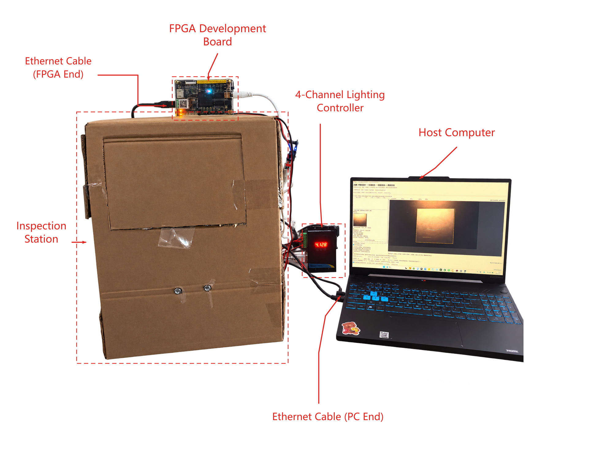

# 光鉴—多光照融合表面缺陷检测台

2026 年 FPGA 创新设计赛道 AMD 自主选题初赛项目

固定版本：[v1.0.1](https://github.com/TJin-667/guangjian-fpga/releases/tag/v1.0.1) · [提交要求对照](docs/competition_requirements.md) · [外部依赖](docs/external_dependencies.md) · [审查修订与提交状态](docs/submission_status.md)

光鉴使用四方向照明与双曝光观察金属试片表面，通过 FPGA 采集、局部整数计算及跨帧融合，并由 PC 完成弱段增强、局部复检和结果归档。项目面向表面划痕的辅助观察，保留原片和证据供人工判断。



硬件为 BX72-V1.1、Artix-7 `xc7a100tfgg484-2`、OV5640、外部 DDR 与四路照明；PC 通过以太网调度。系统采用纯 PL 配外部 PC。当前功能验证版本为 **0109 + 独立 v1.8**，算法冻结号 `f09eb5885e1d`，检测器 `387cfeac0426`。本仓库对应 2026 AMD 自主选题初赛提交整理版，具体文件身份见 `release_manifest.json`。

## 公开范围与外部依赖

本库公开团队自研源码、配置、完整离线案例、报告及展示材料。232 项受限或未明确获准再分发的第三方文件不随 Git 或公开 RAR 发布，逐项列于 `external_dependencies.json`；包括工具生成 IP、部分板级参考、相机配置及含相关代码的既有位流。原始哈希和来源保留，未删除完整性验证。

**离线胶囊回放可以直接运行。完整主机 API、GUI 和 FPGA 构建须先合法取得并恢复外部依赖。** 本公开快照不宣称仅克隆即可完成整套硬件重建。[依赖清单与恢复方法](docs/external_dependencies.md)

## 从这里开始

| 目的 | 入口 | 适用范围 |
| --- | --- | --- |
| 无板查看与回放 | [离线复现](docs/quickstart_offline.md) | 代表性 004 八帧案例来自旧 0108；验证冻结数学结果，不代替新 0109 板测。 |
| 恢复依赖后使用现有工件 | [上板说明](docs/quickstart_board.md) | 指定板卡、位流与主机组合；先核对接线、参数和版本。 |
| 恢复依赖后从源码构建 | [构建说明](docs/build_from_source.md) | 实际工程使用 Vivado 2018.3；工具、IP 和路径前置见该文档。 |
| 了解硬件和通信 | [硬件说明](board/hardware/README.md) · [协议](docs/protocol.md) | 控制、图像、质量表与 R32 使用各自的格式与完成条件。 |
| 查看结果和边界 | [验证说明](docs/validation.md) · [证据索引](report/evidence_index.md) · [已知限制](docs/known_limitations.md) | 区分实拍、仿真、软件回放和历史性能结果。 |
| 接续开发 | [维护交接](docs/handover.md) | 模块入口、职责、回归及复赛待办。 |

## 离线快速开始

Windows、Python 3.11；依赖版本已锁定，不复制开发者原虚拟环境。在仓库根目录执行：

```powershell
py -3.11 -m venv .venv
& ./.venv/Scripts/python.exe -m pip install -r requirements-offline.txt
$env:OPENBLAS_CORETYPE = 'Prescott'
& ./.venv/Scripts/python.exe -B scripts/replay_example.py --out _work/capsule_replay_01
```

成功状态为 `PASS_RELOCATABLE_FROZEN_REPLAY`。复检浮点记录采用原参考的 OpenBLAS `Prescott` 内核；需在启动 Python 前设置上面的环境变量，不能仅锁包版本。它复算已有 004 八帧与冻结结果，不连接硬件。当前主机 API 的回放、GUI 检查及工程重建见对应复现说明，各有独立的验证范围。

## 系统如何工作

操作者先调焦并确认 ROI、工件 mask 和曝光对。每组采集 1 张准备帧，再按 CH1 低/高至 CH4 低/高获取 8 张正式观测。400/800 行是多轮开发后的推荐默认，允许组间人工微调，组内固定并读回；程序不自动选择曝光或旋转取正。

PL 复用灰度、行缓存和 9×9 整数残差计算链，结合 PC 下发的精确质量表逐帧更新有效 MaxAbs 状态，并可靠提交 R32。PC 保留原片核验和工程镜像，完成全局连接、受控弱段增强、局部复检、证据支持分和完整图文导出。独立 v1.8 复用工程审计已生成的八帧数组，减少重复交接与计算。[详细架构](docs/architecture.md)

## 已有结果

| 项目 | 结果 | 解释与证据 |
| --- | --- | --- |
| 0109 整板资源 | LUT 26,035；FF 32,269；DSP 12；BRAM 81.5/135（60.37%） | 布线后整板结果；外部 IO 尚未完整签核。[EV01](report/evidence_index.md#ev01) |
| 格式 50→49 的接收载荷 | 减少 54.51% | 同 ROI 两个 cold 组的 SDK 接收 UDP 应用载荷；包含准备/协议/R32，不含线路头，也不是速度提升。[EV02](report/evidence_index.md#ev02) |
| 同输入软件交接至完整导出 | 三组中位耗时下降 15.35%～17.05% | 两分支每组各 3 次，共 18 次；不含采集、PL/FETCH 和公共审计数组生产。[EV03](report/evidence_index.md#ev03) |
| 同输入一致性 | 最终十项数组、完整复检和分数一致；72 对导出图像逐像素一致 | 证明实现和交接保持结果，不是检测准确率。[EV03](report/evidence_index.md#ev03) |

旧主机完整任务 A/B 中 PL 协作路径更慢；新版整机 PC/PL A/B 和纯 FPGA 算术加速比仍未测定。25 组 200 帧来自 003/004/005 三块开发样品；006 是冻结后的一块补充工件，其 M45 复检框已确认非划痕。橙框、H/M 优先级及证据支持分供人工复核，不提供自动合格判定。[验证范围](docs/validation.md)

## 展示与材料

- [中文海报预览](report/media/poster_zh.png) · [可编辑中文海报](report/media/poster_zh.pptx)
- [英文海报预览](report/media/poster_en.png) · [可编辑英文海报](report/media/poster_en.pptx)
- [正式技术报告与协作记录说明](report/README.md)
- [普通主机计时 Skill](skill/README.md)

海报保留经确认的署名与校徽，姓名使用“谢东霖”。报告与视频按比赛要求分别处理匿名信息。海报中的 004 弱段消融、另一组 004 复检以及 006 曝光对照各有独立身份，不能拼成同一次采集。

## 仓库内容

`src/` 保存 FPGA、主机和冻结算法；`configs/` 保存参数；`sim/` 保存验证入口与结果；工程构建输入位于 `src/fpga/implemented/`，构建入口位于 `scripts/`，报告位于 `board/results/`；`board/` 保存硬件与上板材料；`data/` 保存样例和参考结果；`skill/` 保存复用工具；`report/` 保存报告、证据与协作；`docs/` 保存使用和维护说明。[提交目录对照](docs/submission_mapping.md)

团队有权授权的自研部分采用 [MIT](LICENSE)。受限外部文件不在公开快照内，恢复文件受原许可约束。第三方代码、IP、库、照片及标识按各自声明适用，见 [第三方来源说明](third_party_notices.md)。独立 v1.8、算法、RTL、bit 和参数必须按同一发布清单使用；后续版本另行发布，不覆盖已提交版本。
