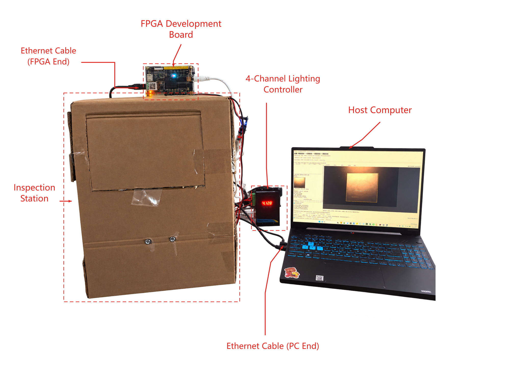
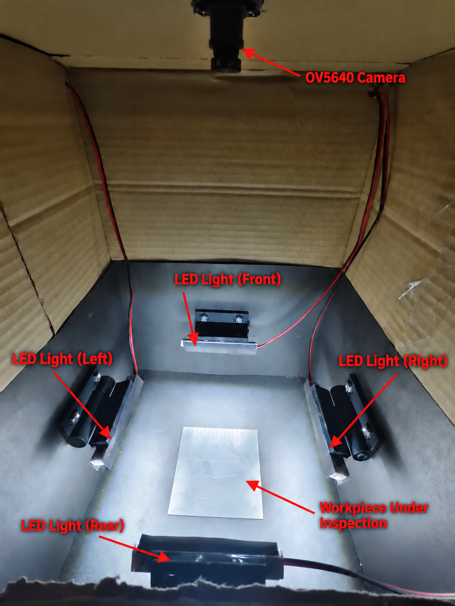

# 硬件组成与装配说明

系统使用 BX72-V1.1，器件 Artix-7 `xc7a100tfgg484-2`，OV5640 相机、四路定向照明、外部 DDR 和 PC。以太网用于 PC 与 FPGA 之间的控制和数据传输。

两图直接取自已确认海报中的实物图片，保持原图字节，不作为重新测量或新增实拍。相机、灯位与待测工件的相对位置由照片辅助说明，实际通道映射见[接线与灯位](wiring.md)。

| 确认项 | 当前内容 |
| --- | --- |
| 开发板/器件 | BX72-V1.1 / xc7a100tfgg484-2。 |
| 相机 | OV5640，DVP 图像接入，SCCB 配置。 |
| PC 链路 | 开发板左侧黑线为连接 PC 的以太网线。 |
| 板卡供电 | 开发板右侧白线是板卡电源；额定电压、电流和插头极性须按实物标识及板卡资料核对。 |
| 灯位 | 靠里前侧 CH1、右侧 CH2、开口后侧 CH3、左侧 CH4。 |
| 采集 | 默认 400/800 行、gain16=16、LED128；实际按组读回记录。 |

[BOM](bom.csv) 标记哪些规格已确认，哪些需要集成方补充。本文不提供未经核实的供电数值、排针号或灯驱动接法。上板前先按最终工程约束和厂商资料核实电气连接，再执行[上板流程](../../docs/quickstart_board.md)。
