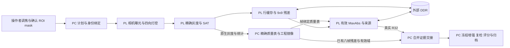

# 系统架构与实现分工

系统由相机与四路照明、BX72-V1.1 上的 Artix-7 PL 和外部 DDR、Windows PC 组成。图像采集与局部整数运算位于 PL，全局几何判断和复检保留在 PC。

## 计算和控制在哪里发生

| 位置 | 工作 |
| --- | --- |
| PC 控制 | 调焦与清晰度辅助、ROI/mask 人工确认、组计划、参数与身份核验、32×32 精确质量表、同会话配置复用。 |
| PL | 相机/曝光/四向灯控、ROI 执行裁剪、RGB565 精确灰度与 SAT/H1/H2、9×9 整数残差、有效 MaxAbs、符号/来源、R32、DDR 双 bank 提交、身份/CRC/错误状态与本域计数。 |
| PC 审计及最终算法 | 原片严格核验、工程镜像、全局强弱连接、结构保护、受控弱段增强、端部补充、局部复检、证据支持分、归档与显示。 |
| 外部 DDR | 原始与 scratch 平面、融合工作状态和已提交状态；地址预留共 32 MiB。 |

正式观测顺序为 CH1 低/高、CH2 低/高、CH3 低/高、CH4 低/高，之前另有 1 张准备帧。曝光对在组内锁定并读回，推荐 400/800 行、gain16=16、LED128；组间人工调整的实际值随证据保留。

## 数值语义

RGB565 按冻结规则展开后，`gray=(9798R+19235G+3735B+16384)>>15`。9×9 残差保留整数分子 `R_n=81*gray-sum9`，边界采用保存 ROI 下的 REFLECT_101 语义。有效性表以保存 ROI 左上角锚定的 32×32 块计算，边缘不足一块也独立处理；质量表缺失不能默认整帧有效。

MaxAbs 选择有效且绝对值最大的响应，保留亮暗符号与来源；等幅时按固定八帧顺序保留更早来源。R32 是每像素 4 字节的打包记录，包含残差、来源、基础强弱标志和选中灰度，不能将整个字解释为一个 signed 残差值。

工件二值 mask 按**每像素 1 位，每 32 像素打包为一个 32 位字**存储。该规则不改变 GRAY8、R32 或最终算法数组的数据类型。mask 与 ROI 的用途、内容及坐标分别核对，不用显示缩放代替执行坐标。

## 为什么采用这种分工

局部邻域使用行缓存，整帧和跨帧状态使用外部 DDR；八次观测复用计算链。融合逐帧更新固定规模状态，双 bank 使失败帧不破坏已提交结果。精确整数和固定并列规则用于保持软硬件同输入一致性。

0107 至 0109 整板 BRAM 均为 81.5/135，但 LUT/FF/DSP 增加，DDR 预留由 8 MiB 变为 32 MiB，并增加外存访问。这是计算与存储之间的具体取舍。回复缓存改为唯一同步写入口另有综合和布线报告支持；不能把未布线的早期综合结果当作另一版实板资源。

v1.8 的改进发生在主机交接：重用工程审计已经存在的八帧残差和 valid，一次无损合并交接，随后仍执行 PC 冻结后处理。若未来取消 PC 镜像审计，必须重新评估这些数组的生产成本。[证据与验证](validation.md)
