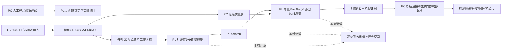

# 0109 独立收尾候选：人工曝光配置与器件分段计数

本目录是0108的独立后继，供集中实板验收。现用0108、旧09、0107、原入口及冻结检测/复检 f09eb5885e1d 均保留。**源码、仿真或实现通过，不等于本版实板通过，也不等于生产发布。** 本版的实际位流、来源绑定和实板状态以独立发布收据为准；不自动烧录、连接板卡或调整网卡/Cisco。

## 本次完成的范围

- 一组BEGIN时锁定人工设置的低/高曝光，1～1116行整数且低值小于高值；逐帧ARM和实际相机参数仍独立核对。默认正式组合400/800，gain16=16、LED128、settle1/discard3，CH1低高→CH4低高。其他组合是开发对照，不是重新调参或自适应曝光。
- 读取NET125MHz的H2服务、UI100MHz的scratch写入和融合服务计数，附完成握手数、观察到的背压周期、组/帧/请求身份、有效/溢出检查。详见[协议](PROTOCOL.md)。
- 独立 v1.7 候选入口，支持人工样品名、曝光值、2fps调焦/鼠标框选、定位、同摆放连续组复用mask、8张原片对比、冻结检测和局部复检。启动和check-only仅离线检查；点击硬件操作后才连接。
- PROFILE与CONFIG使用原有已确认CDC回复通道，宽度不扩张；缓存统一为一个同步写入口，避免多写入口导致Vivado把分布式RAM展开成寄存器。首轮展开问题与更正保留在验证记录，不用失败版本生成bit。

## PL与PC分工保持不变

PL承担相机/四方向照明时序、实际曝光/增益执行与读回、帧身份/ROI/mask、同帧RGB565→精确GRAY8/SAT1、9×9背景整数残差、DDR scratch、按PC精确质量表筛选的逐帧MaxAbs融合、符号/来源/R32保存及双bank可靠提交；本版另增加曝光组配置和本域计数。

PC承担工件几何交互、原冻结32×32质量评价与有效表上传、8/20原检测连接、6/20保护结构、冻结弱段补充及其约束、原片局部证据/端部增强、55%原片门槛/28%端点复检、证据分、人工复检提示、归档与界面。新0109没有声称把这些后处理全部迁入PL。

数值核心仍为 `R_n = 81×gray−sum9`，REFLECT101与原ROI坐标不变；MaxAbs并列保持原顺序。新增控制、存储端口和计时改动不允许改变检测/复检参数。

## 阅读顺序

1. 本说明与[协议](PROTOCOL.md)。
2. [操作及最小实板窗口](USER_GUIDE_ZH.md)。
3. `verification/`中的实际测试/实现收据；大日志、原生报告与checkpoint在E盘对应目录，文件哈希保留。
4. `derive_candidate.py`、`derive_host.py`、`derive_runtime.py`及DERIVATION记录，说明继承了哪些固定Git原件。
5. `SOURCE_BINDING.json`和发布目录中的bit/route/qualification收据。`verify_bundle.py --git-head`在发出bit前验证实际已提交字节；`host/qualification.py`在真实socket构造前验证源码、checkpoint、bit及路线审计。

## 复跑与边界

全部测试目录必须新建，失败日志保留，不覆盖已有实板原件。Python需已有numpy/OpenCV/Pillow；RTL使用Vivado2018.3。`run_net_checks.py`、`run_board_checks.py`、`audit_board_packets.py`、`run_sdk_checks.py`、`run_runtime_checks.py`、`run_reset_checks.py`均以`--out 新E盘目录`执行。`build_candidate.py`仅实现；审计通过、源码提交封印后才运行`finish_engineering_candidate.py`。没有下载动作。

器件计数是**包含DDR、CDC和背压的服务周期**。H2与scratch重叠，不能跨域相加或相减；“服务周期减阻塞周期”也不是纯算术周期。软件UDP peer的计数仅为测试模型，不能写进比赛性能表。旧真实数据没有本版计数，不能补写成新实测。

外部IO时序预算与完整板级签核仍依赖已经列明的硬件证据；保留原约束，不为通过检查虚填delay。007～010仍为保留工件，本次软件和仿真不消耗它们。
